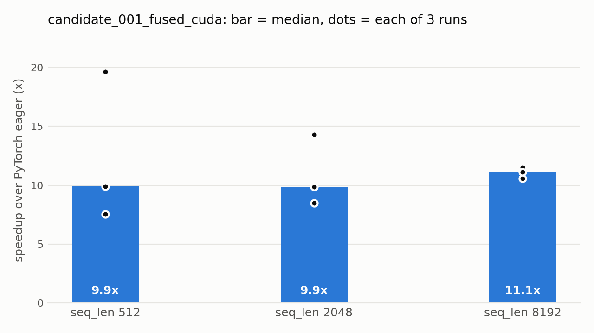

# kda-tasks

A fused CUDA kernel for **Kimi Delta Attention** (KDA) on a consumer GPU
(RTX 4070 SUPER, sm_89), built with the contract -> draft -> plan -> implement
-> validate -> promote loop from NVIDIA's
[Kernel Design Agents](https://nvlabs.github.io/kda/blog/2026-09-27-kda-for-kda/)
methodology.

The blog's own benchmark (KDAttn/FlashKDA on a B300) relies on Hopper/Blackwell
features (TMA, tcgen05) that Ada doesn't have. This repo applies the same
workflow to tasks that fit sm_89.

## Results

| Task | Result |
|---|---|
| [KDA attention forward](kda-attention-sm89/) (original kernel) | 15/15 validation cases pass, max error about 3e-7 (tolerance 2e-2). About 7.5-20x faster than the PyTorch-eager chunkwise reference, depending on seq_len and run. |
| [GEMM rehearsal](gemm-sm89/) (NVIDIA's CUTLASS example, tuned) | 73.4 TFLOPs at 4096^3 fp16, 107% of cuBLAS (68.5 TFLOPs). |

Measured on an RTX 4070 SUPER under WSL2, CUDA 12.8, torch 2.14.1+cu130. Raw
numbers are in each task's `benchmark.csv`; every run is appended, with the GPU,
torch version and date. The first two attention runs predate that metadata: their
GPU and torch columns were filled in afterwards from the project notes and their
date is blank.



Only three runs are recorded so far. The spread (for example 7.5x vs 19.7x at
seq_len 512) comes mostly from the eager baseline's timing varying between runs,
not the kernel, so treat the speedup as an order of magnitude, not a precise
figure.

### kda-attention-sm89: the original work

A fused CUDA C++ kernel for the chunkwise-DPLR forward pass of KDA
([arXiv:2510.26692](https://arxiv.org/abs/2510.26692)), validated against an
independent oracle. `candidates/candidate_001_fused_cuda/` runs one kernel
launch per 64-row chunk, one CTA per (batch*head), 128 threads and about 80 KB
of dynamic shared memory. It uses scalar FMA and no tensor cores.

Two design points are worth reading in [`docs/draft.md`](kda-attention-sm89/docs/draft.md):

- **Separable decay.** The reference materializes a `(C, C, d_h)` ratio tensor
  `Gamma_t[h] / Gamma_s[h]`. It is multiplicatively separable, so after
  pre-multiplying the decay into `k` and `q` (`K_bar = k*Gamma`,
  `K_tilde = k/Gamma`, `Q_tilde = q*Gamma`), the coupling and intra-chunk terms
  are plain small GEMMs. The large intermediate is never needed on-device.
- **Sync-free forward substitution.** The one sequential step, over a chunk's
  64 rows, never mixes value channels. It parallelizes across the 128 value
  threads with no `__syncthreads()` inside the loop.

The PyTorch-eager baseline is slow mainly because its triangular inversion
issues one CUDA op per row (63 tiny launches per chunk). Much of the speedup is
launch overhead avoided, not a claim of peak hardware efficiency.

### gemm-sm89: toolchain rehearsal

This runs NVIDIA's unmodified Ampere `tensorop_gemm.py` (CuTe-DSL) and sweeps
only `atom_layout_mnk`: `(1,1,1)` reaches 9% of cuBLAS, `(2,2,1)` reaches 107%.
It is a rehearsal of the workflow and a check that CuTe-DSL works on sm_89. The
kernel is NVIDIA's, not mine.

## Setup

Requirements: an NVIDIA GPU with compute capability 8.9 (the `nvcc` flag is
`-arch=sm_89`), CUDA toolkit 12.x and Python 3.

```bash
pip install -r requirements-dev.txt   # torch, numpy, einops, pytest, ruff, matplotlib
# torch must be a CUDA build for your driver; see https://pytorch.org/get-started/locally/

# oracle (reference implementation the kernel is validated against)
git clone https://github.com/hwilner/kimi-delta-attention ~/kimi-delta-attention
# override the location with KDA_ORACLE_DIR

# build the kernel
bash kda-attention-sm89/candidates/candidate_001_fused_cuda/compile.sh

# validate and benchmark
cd kda-attention-sm89
python3 validate.py [candidate_name]    # default candidate_001_fused_cuda; expect ALL PASS (15 cases)
python3 benchmark.py [candidate_name]   # appends to benchmark.csv
```

For the GEMM rehearsal, also `pip install -r requirements-gemm.txt` and check
out [NVIDIA/cutlass](https://github.com/NVIDIA/cutlass) to `~/cutlass-ref`
(`examples/python/CuTeDSL` is what's used; override with
`CUTLASS_CUTE_DSL_DIR`). Then:

```bash
python3 gemm-sm89/benchmark.py
```

To add a candidate, create `kda-attention-sm89/candidates/candidate_002_<name>/`
with a `kernel.py` that exposes `forward(q, k, v, alpha, beta, chunk_size=64)`.
`validate.py` and `benchmark.py` need no changes.

## Tests and development

```bash
make build      # compile libkda.so
make test       # pytest: 16 tests per candidate, about 5 seconds
make validate   # the 15-case script from validate.py
make bench      # append a row set to benchmark.csv
make plot       # regenerate kda-attention-sm89/docs/speedup.png
make lint       # ruff
```

`CANDIDATE=candidate_002_<name>` selects another candidate for `build`,
`validate` and `bench`. `make test` already runs every `candidates/*/kernel.py`
it finds.

The tests in [`tests/`](tests/) compare each candidate against both the chunkwise
reference and the naive O(L) recurrence. They cover sequence lengths that are not
a multiple of the chunk size, batch sizes 1 and 3, non-contiguous inputs,
repeated calls (the kernel updates state in place) and output shapes and dtypes.
They skip themselves when there is no sm_89 GPU or the oracle repo is missing.
I checked that they fail on a deliberately wrong kernel (14 of 16 fail). The
other two only check shapes and repeat calls, not values.

CI (`.github/workflows/lint.yml`) runs `ruff` and a syntax check only. GitHub's
hosted runners have no GPU, so the kernel tests run locally.

## Repo layout

Each task has `docs/` (contract, draft, plan), `candidates.jsonl` (one record
per candidate with status and evidence) and `benchmark.csv`. `runs/` and
`profile/` are placeholders for logs and Nsight output. `libkda.so` is a build
product and is not committed.

## Limitations and next steps

- candidate_001 launches only 8 CTAs (batch 2 x 4 heads), well below the 36 SMs
  of a 4070 SUPER, and uses no tensor cores. Both are hypotheses, not profiled
  findings.
- Nsight Compute fails under WSL with `ERR_NVGPUCTRPERM` until GPU performance
  counters are enabled on the Windows host. Profiling is the next step before
  candidate_002 (more CTAs, `mma.sync` for the GEMM-shaped steps).

## Credits

- Methodology: [NVlabs/kda](https://github.com/NVlabs/kda).
- Oracle (MIT): [hwilner/kimi-delta-attention](https://github.com/hwilner/kimi-delta-attention).
- GEMM example: [NVIDIA/cutlass](https://github.com/NVIDIA/cutlass), not included here.
- Algorithm: Kimi Linear, [arXiv:2510.26692](https://arxiv.org/abs/2510.26692).
- Developed with [Claude Code](https://claude.com/claude-code).

## License

MIT, see [LICENSE](LICENSE).
